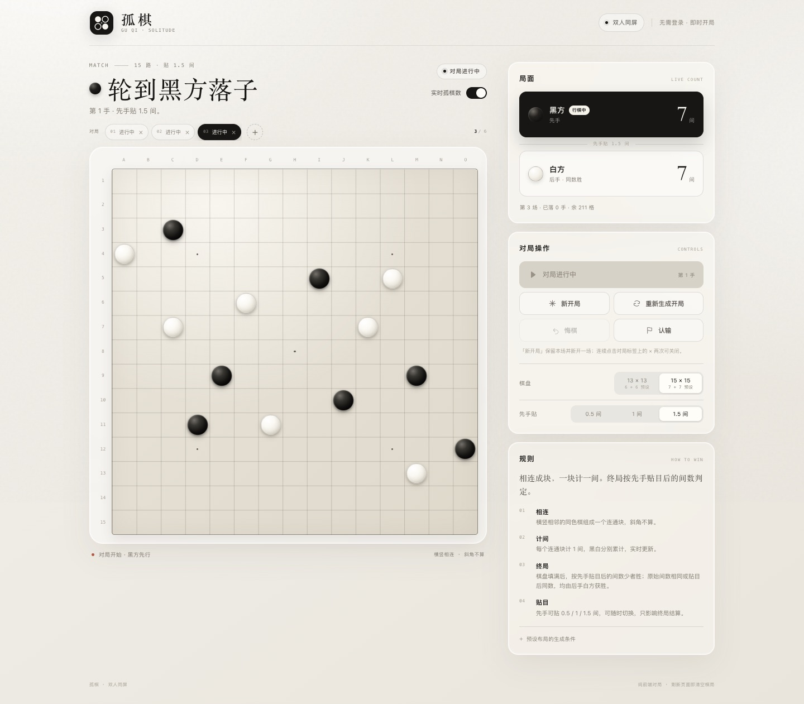

# 孤棋 · GU QI

[](https://github.com/Ouheeeee/guqi/actions/workflows/pages.yml)
[](https://ouheeeee.github.io/guqi/)

一款双人同屏的极简连线围棋变体。支持三种先手贴目规则、最多 6 场并行对局，纯前端实现，不需要后端、登录或数据库。



## 在线访问

- **GitHub Pages：<https://ouheeeee.github.io/guqi/>**
- **GitHub 仓库：<https://github.com/Ouheeeee/guqi>**

网站内容公开展示，请勿将私人信息放入对局页面。

## 功能

- **三种判定规则**：先手贴 0.5 间、1 间或 1.5 间，可随时切换。
- **贴目结算**：终局比较「黑方原始间数 + 先手贴目」与「白方原始间数」，少者获胜；原始间数相同或贴目后同数，均由后手白方获胜。
- **多场并行**：最多同时保留 6 场对局，可随时搁置当前对局、切换或开启新对局。
- **独立设置**：每场对局独立保存棋盘尺寸、贴目规则、落子历史与结果。
- **完整操作**：开始对局、重新生成布局、悔棋、认输、关闭本场。
- **实时孤棋数**：默认开启，可隐藏；每场对局分别计算。
- **双端适配**：桌面和手机均可用，支持触控与键盘方向键落子。

## 本地运行

```bash
npm run serve
# 打开 http://localhost:4173
```

或使用任意静态文件服务器：

```bash
npx serve site
```

## 测试

```bash
npm test
```

测试覆盖：

- 13 路 / 15 路预设布局的中心对称、四象限分布、切比雪夫距离、中心 3×3 为空、最外层有子且不过度贴边；
- 横竖连通块计数与斜角不连通；
- 三种先手贴目规则、原始同数与贴目同数的裁定；
- 每场对局独立保存贴目，终局后切换规则可重新裁定；
- 25 手连续落子与悔棋还原；
- 认输、棋盘填满结算；
- 非法尺寸与非法贴目防御。

## 规则

1. 13×13 双方各 6 枚预设子；15×15 双方各 7 枚预设子。
2. 预设布局每局随机生成：黑白中心对称、四象限双方均有子、任意两子切比雪夫距离 ≥ 2、中心 3×3 为空；最外层至少有一枚预设子，并会在多组候选中择优，让棋子分布更均匀、避免全部向边缘集中或同色扎堆。
3. 黑方先行，双方轮流在空格落子。
4. 横竖相邻的同色棋组成一个连通块，每个连通块计 **1 间**；斜角不算。
5. 终局按「黑方原始间数 + 先手贴目」与「白方原始间数」比较，少者获胜。
6. 先手贴目可选 0.5 / 1 / 1.5 间，可随时切换，只影响终局结算。
7. 原始间数相同，或贴目后同数，均由后手白方获胜。
8. 当前行棋方可以认输。悔棋支持撤销本场全部落子记录。

## 交互说明

- **对局栏**：顶部显示全部进行中的对局，点击切换；每场标签带 **×** 关闭按钮，二次点击确认；状态包括待开始、进行中、已结束。
- **新开局**：保留当前对局，按当前棋盘尺寸和贴目规则开启一场新对局并立即开始。
- **重新生成开局**：只更换当前对局的预设布局，不开始对局。
- **开始对局**：预设布局确定后开始，黑方先行。
- **悔棋**：撤销当前对局上一手，并实时重算间数；终局后也可悔棋复盘。
- **认输**：当前行棋方认输，对方立即获胜。
- **关闭对局**：连续点击顶部对局标签上的 **×** 两次确认关闭对应场次；关闭最后一场时会自动新建一场布局，最多同时保留 6 场。
- **棋盘 / 贴目**：分别切换当前对局的棋盘尺寸与先手贴目规则，棋盘切换会重置本场布局。
- **实时孤棋数**：默认开启；关闭后隐藏双方原始间数，但不影响贴目后的结算。

## 部署

站点产物位于 `site/`，可直接部署到任意静态托管平台。

### GitHub Pages（自动部署）

仓库已配置 [`.github/workflows/pages.yml`](.github/workflows/pages.yml)：推送到 `main` 分支后，GitHub Actions 会自动把 `site/` 发布到 GitHub Pages。

线上地址：<https://ouheeeee.github.io/guqi/>

### 单文件构建

```bash
npm run build:single
# 生成 dist/guqi-standalone.html
```

该文件内联全部 CSS、JavaScript 与 favicon，可直接上传到只接受单页 HTML 的托管服务。

### Vercel

```bash
npx vercel ./site --prod
```

### Netlify

将 `site/` 目录拖入 Netlify Drop，或执行：

```bash
npx netlify deploy --dir=site --prod
```

### ShipStatic

```bash
npx @shipstatic/ship ./site
```

## 项目结构

```text
site/                 # 可直接部署的静态站点
  index.html
  styles.css
  game.js             # 规则引擎、贴目与随机布局生成
  app.js              # 多场对局管理、交互与渲染
tests/game.test.mjs   # Node 规则测试
scripts/build-single.mjs
.github/workflows/    # GitHub Pages 自动部署
```

## 技术栈

- 原生 HTML / CSS / JavaScript（ES Modules）
- 无构建步骤、无第三方运行时依赖
- CSS Grid 棋盘、响应式布局、键盘方向键与对局切换
- 可访问的结果模态框（焦点陷阱、Escape 关闭、背景 inert）
